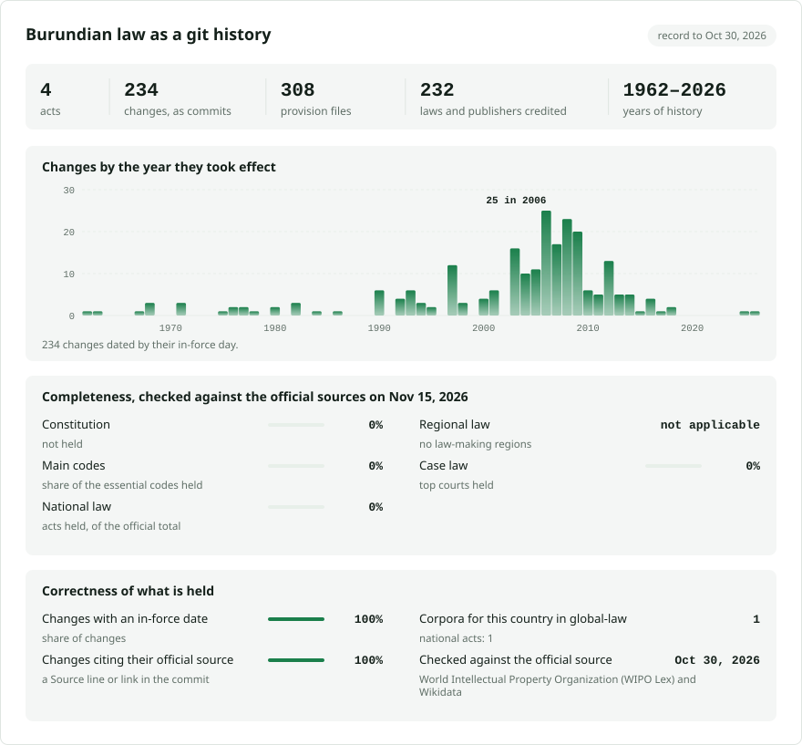

# Burundi: law history in git

[Français](README.md) · **English**

<picture>
<source media="(prefers-color-scheme: dark)" srcset="data/effort-dark.svg">

</picture>

The law of Burundi as a git history: one folder per act published in the Bulletin Officiel du Burundi (BOB), one file per article, one commit per act on the day of the act, and the act itself as the commit's author. `git log` lists every act with its day; `git blame` names the act behind each line.

Part of [lexifina/global-law](https://github.com/lexifina/global-law), one git history for every country's law: this is Burundi's national law, which global-law reads at `burundi/national/acts/`.

**What is in it now:** the text of the lois, décrets, ordonnances and other acts printed in the BOB issues that the Ministry of Justice's portal [amategeko.gov.bi](https://amategeko.gov.bi) publishes with a text layer (the build is running and adds issues as it goes), filed by type and year as [`STRUCTURE.md`](STRUCTURE.md) describes; codes enacted as a whole are in `codes/`. The earlier record of law titles and treaty actions without text is still in `catalogue/`, `treaties/`, `un-treaties/` and `legal-system/`.

Each act is a folder: `decrets/2023/100-193-modalites-pratiques-de-levee-du-gel-d-avancement/` is Décret n°100/193 of 1 September 2023, with its heading, title and visas in `preambule.md` and each article in `article-001.md`, `article-002.md` and so on.

The text is in French, as the BOB prints it. Issues from before about 2010 are page scans whose only text is the publisher's own OCR layer: those acts are taken as that layer reads them, with its reading errors, and their commits say `Text-source: publisher OCR (known reading errors)`; pages whose OCR text is unusable (mostly garbage characters) are skipped. No OCR is run here.

## Questions as git commands

| Question | Command |
| --- | --- |
| Every act on record, with its day | `git log --format="%h %(trailers:key=In-force,valueonly,separator=) %an"` |
| The lois of 2023 | `git log --format="%(trailers:key=In-force,valueonly,separator=) %s" -- lois/2023` |
| Where an act was printed (BOB issue, page, PDF) | `git log --format="%(trailers:key=Source,valueonly)" -- decrets/2023/100-193-*` |
| What has Burundi signed, ratified or joined, and on what day? | `git log --format="%h %(trailers:key=In-force,valueonly,separator=) %an" -- treaties un-treaties` |

**Outside git**, we also host this record publicly, for free:

- **[Ask Claude about Burundian law](https://global-law.lexifina.com/v1/try_claude?country=burundi)**: opens Claude with a first question ready.
- **[Ask ChatGPT](https://global-law.lexifina.com/v1/try_chatgpt?country=burundi)**: the same question in ChatGPT.
- **[Search the Burundi record on our site](https://lexifina.com/law?country=burundi&q=copyright)**: a search of its record, no account needed.
- **[Developer REST API](https://global-law.lexifina.com/v1/search_law?query=copyright&jurisdiction=burundi)**: the same search as JSON, with no key. See the [documentation here](https://lexifina.com/api/global-law).

Both assistants read the record through the free Global law connector (MCP, `https://global-law.lexifina.com/mcp`); the first time, the chat gives you the link that adds it. Ask in English or in French.

**Host it yourself easily.** All it takes is git and Python, and the tools run on your machine:

```sh
git clone --depth 1 https://github.com/lexifina/global-law && cd global-law
python3 tools/countries.py add burundi/national/acts
```

Opened in Claude Code, Cursor, VS Code or Codex, the clone also starts a local MCP server with the same tools ([MCP.md](https://github.com/lexifina/global-law/blob/main/MCP.md)).

## Dates

Each act's commit is dated at noon, Africa/Bujumbura, on the date of the act as printed in its heading (its signature or promulgation), and carries that day in its `In-force:` trailer. `In-force-basis:` says so and quotes the act's own clause where it has one (most say "entre en vigueur le jour de sa signature" or "de sa promulgation"); an act that enters into force on publication in the BOB is still dated by its own date, as the BOB issues carry no day of publication. `Source:` names the BOB issue, page and PDF, and `Text-source:` says the text is the publisher's own text layer.

git cannot store dates before 1970: such commits are dated 1970-01-01 with the real day in the subject and in `In-force:`.

The author of each act's commit is the act itself (for example `Décret n°100/193 du 1er septembre 2023`), with an e-mail address that cannot exist; the committer is always Lexifina. The older catalogue and treaty entries are credited as before (a key naming the record).

## What it does not show

- **BOB issues with no text at all.** Issues whose PDF is a scan with no text layer (many from 1962 to 2009, and BOB n°6/2018, which prints the 2018 Constitution) are not included, and no OCR is run here; they are listed in [`REPRODUCE.md`](REPRODUCE.md). In the older issues taken from the publisher's OCR, an act whose heading was misread sits inside the act before it, and Kirundi text printed beside the French may be mixed in.
- **Consolidated texts.** Each act is held as printed. An act that amends another is its own folder; its changes are not yet applied to the act it amends. Codes enacted or recast as a whole are versions of one folder in `codes/`.
- **The *Divers* part of each issue** (court notices served on named persons, company notices): not legislation.
- **Acts after the last BOB on the portal.** The portal's latest issues are from early 2024; the Présidence (presidence.gov.bi) posts later décrets mostly as scans.

## Sources

| Source | Kind | Past versions | Notes |
| --- | --- | --- | --- |
| [Mémoire du Droit Burundais](https://amategeko.gov.bi) (Ministry of Justice) | Bulletin Officiel du Burundi, issue PDFs, 1962-2024 | every act as printed | Text layer of born-digital issues; scanned issues held |
| [WIPO Lex](https://www.wipo.int/wipolex/en/members/profile/BI) (World Intellectual Property Organization) | Catalogue of laws; treaty actions | no | Title, subject, dates and link; no text |
| [Assemblée nationale du Burundi](https://assemblee.bi/) | Laws of 2003-2012, as PDFs | no | Number and promulgation date from each file name |
| [UN Treaty Collection](https://treaties.un.org/) | Multilateral treaties deposited with the UN Secretary-General | each action by Burundi | Action dates |
| [Wikidata](https://www.wikidata.org/) | Legal system | no | Open facts |

## Licence

See [`LICENSE`](LICENSE). The law text is official text of the Republic of Burundi, outside copyright under its copyright act (Loi n°1/021 du 30 décembre 2005); WIPO Lex facts are CC BY 4.0 and credited to WIPO, which does not endorse this repository; Wikidata's facts are CC0. The history, commit messages, tables and tools are CC0 1.0.

No AI model wrote, translated or corrected legal text, and none runs when the history is built; the scripts were written by an AI model (see [`REPRODUCE.md`](REPRODUCE.md)).

## Visualisations

- [visualisations/](visualisations/): charts drawn from this repository. Not drawn yet.

**Case law** is in a separate repository, [lexifina/burundi-law-caselaw](https://github.com/lexifina/burundi-law-caselaw): arrêts of the Cour constitutionnelle as printed in the BOB, one file and one commit per arrêt.

## More

From [lexifina/global-law](https://github.com/lexifina/global-law):

- [FEATURES.md](https://github.com/lexifina/global-law/blob/main/FEATURES.md): every feature, and what every corpus must support (`git blame`, `law.py`, the MCP tools)
- [FAQ.md](https://github.com/lexifina/global-law/blob/main/FAQ.md): questions and answers · [CONTRIBUTING.md](https://github.com/lexifina/global-law/blob/main/CONTRIBUTING.md): proposing changes · [MCP.md](https://github.com/lexifina/global-law/blob/main/MCP.md): the MCP server · [REPRODUCE.md](https://github.com/lexifina/global-law/blob/main/REPRODUCE.md): how it was built · [CHANGELOG.md](https://github.com/lexifina/global-law/blob/main/CHANGELOG.md)
- [FRESHNESS.md](https://github.com/lexifina/global-law/blob/main/FRESHNESS.md): how current each corpus is · [Monitoring](https://github.com/lexifina/global-law/tree/main/monitoring): whether updates are running · [WATCHING.md](https://github.com/lexifina/global-law/blob/main/WATCHING.md): how each official source is watched for changes
- [performance/](https://github.com/lexifina/global-law/tree/main/performance): how fast the tools are, measured
- [visualisations/](https://github.com/lexifina/global-law/tree/main/visualisations): charts and bridges across the world's law
- [Vulnerabilities](https://github.com/lexifina/global-law/tree/main/vulnerabilities): mistakes in legislation as published
