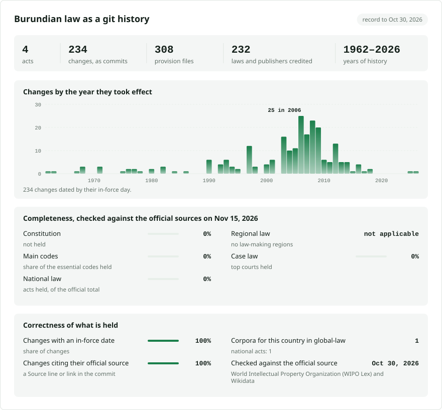

# Burundi : l’historique du droit dans git

**Français** · [English](README.en.md)

<picture>
<source media="(prefers-color-scheme: dark)" srcset="data/effort-dark.svg">

</picture>

Le droit du Burundi sous forme d’historique git : un dossier par acte publié au Bulletin Officiel du Burundi (BOB), un fichier par article, un commit par acte au jour de l’acte, et pour auteur de chaque commit l’acte lui-même. `git log` énumère tous les actes avec leur date ; `git blame` désigne l’acte à l’origine de chaque ligne.

Fait partie de [lexifina/global-law](https://github.com/lexifina/global-law), un historique git unique pour le droit de chaque pays : ce dépôt contient le droit national burundais, que global-law lit dans `burundi/national/acts/`.

**Contenu actuel :** le texte des lois, décrets, ordonnances et autres actes imprimés dans les numéros du BOB que le portail du Ministère de la Justice, [amategeko.gov.bi](https://amategeko.gov.bi), publie avec une couche texte (la construction est en cours et ajoute les numéros au fur et à mesure), classés par type et par année comme le décrit [`STRUCTURE.md`](STRUCTURE.md) ; les codes adoptés d’un seul tenant sont dans `codes/`. Le registre antérieur des titres de lois et des actes conventionnels, sans texte, reste dans `catalogue/`, `treaties/`, `un-treaties/` et `legal-system/`.

Chaque acte est un dossier : `decrets/2023/100-193-modalites-pratiques-de-levee-du-gel-d-avancement/` est le décret n°100/193 du 1er septembre 2023, avec son intitulé, son titre et ses visas dans `preambule.md` et chaque article dans `article-001.md`, `article-002.md`, etc.

Le texte est en français, tel que l’imprime le BOB. Les numéros antérieurs à 2010 environ sont des scans dont le seul texte est la couche OCR de l’éditeur : ces actes sont repris tels que cette couche les lit, avec ses erreurs de lecture, et leurs commits portent `Text-source: publisher OCR (known reading errors)` ; les pages dont le texte OCR est inutilisable (surtout des caractères parasites) sont écartées. Aucune OCR n’est faite ici.

## Questions sous forme de commandes git

| Question | Commande |
| --- | --- |
| Tous les actes enregistrés, avec leur date | `git log --format="%h %(trailers:key=In-force,valueonly,separator=) %an"` |
| Les lois de 2023 | `git log --format="%(trailers:key=In-force,valueonly,separator=) %s" -- lois/2023` |
| Où un acte a été publié (numéro du BOB, page, PDF) | `git log --format="%(trailers:key=Source,valueonly)" -- decrets/2023/100-193-*` |
| Qu’est-ce que le Burundi a signé, ratifié ou adhéré, et à quelle date ? | `git log --format="%h %(trailers:key=In-force,valueonly,separator=) %an" -- treaties un-treaties` |

**En dehors de git**, nous hébergeons aussi ce registre publiquement, gratuitement :

- **[Interroger Claude sur le droit burundais](https://global-law.lexifina.com/v1/try_claude?country=burundi)** : ouvre Claude avec une première question prête.
- **[Interroger ChatGPT](https://global-law.lexifina.com/v1/try_chatgpt?country=burundi)** : la même question dans ChatGPT.
- **[Chercher dans le registre du Burundi sur notre site](https://lexifina.com/law?country=burundi&q=copyright)** : sans compte.
- **[API REST pour développeurs](https://global-law.lexifina.com/v1/search_law?query=copyright&jurisdiction=burundi)** : la même recherche en JSON, sans clé. Voir la [documentation](https://lexifina.com/api/global-law).

Les deux assistants lisent le registre par le connecteur gratuit Global law (MCP, `https://global-law.lexifina.com/mcp`) ; la première fois, la conversation donne le lien qui l’ajoute. Posez vos questions en français ou en anglais.

**L’héberger soi-même, simplement.** Il suffit de git et de Python, et les outils tournent sur votre machine :

```sh
git clone --depth 1 https://github.com/lexifina/global-law && cd global-law
python3 tools/countries.py add burundi/national/acts
```

Ouvert dans Claude Code, Cursor, VS Code ou Codex, le clone lance aussi un serveur MCP local avec les mêmes outils ([MCP.md](https://github.com/lexifina/global-law/blob/main/MCP.md)).

## Dates

Le commit de chaque acte est daté de midi, heure de Bujumbura, au jour de l’acte tel qu’imprimé dans son intitulé (sa signature ou sa promulgation), et porte ce jour dans sa mention `In-force:`. `In-force-basis:` le précise et cite la clause d’entrée en vigueur de l’acte lorsqu’il en a une (le plus souvent « entre en vigueur le jour de sa signature » ou « de sa promulgation ») ; un acte qui entre en vigueur à sa publication au BOB est daté lui aussi de sa propre date, les numéros du BOB ne portant pas de jour de publication. `Source:` indique le numéro du BOB, la page et le PDF, et `Text-source:` que le texte est la couche texte de l’éditeur.

git ne peut pas enregistrer de dates antérieures à 1970 : ces commits sont datés du 1er janvier 1970, avec le jour réel dans l’objet et dans `In-force:`.

L’auteur du commit de chaque acte est l’acte lui-même (par exemple `Décret n°100/193 du 1er septembre 2023`), avec une adresse électronique qui ne peut exister ; le committer est toujours Lexifina. Les entrées antérieures du catalogue et des traités sont attribuées comme auparavant (une clé désignant l’entrée).

## Ce qu’il ne montre pas

- **Les numéros du BOB sans aucun texte.** Les numéros dont le PDF est un scan sans couche texte (beaucoup entre 1962 et 2009, et le BOB n°6/2018, qui publie la Constitution de 2018) ne sont pas repris, et aucune OCR n’est faite ici ; ils sont énumérés dans [`REPRODUCE.md`](REPRODUCE.md). Dans les numéros anciens repris de l’OCR de l’éditeur, un acte dont l’intitulé a été mal lu se trouve dans l’acte qui le précède, et le texte kirundi imprimé à côté du français peut s’y mêler.
- **Les textes consolidés.** Chaque acte est conservé tel que publié. Un acte modificatif est son propre dossier ; ses modifications ne sont pas encore reportées dans l’acte modifié. Les codes adoptés ou refondus d’un seul tenant sont des versions d’un même dossier dans `codes/`.
- **La partie *Divers* de chaque numéro** (significations à des personnes nommées, avis de sociétés) : ce n’est pas de la législation.
- **Les actes postérieurs au dernier BOB du portail.** Les derniers numéros du portail datent du début de 2024 ; la Présidence (presidence.gov.bi) publie les décrets plus récents surtout sous forme de scans.

## Sources

| Source | Nature | Versions antérieures | Remarques |
| --- | --- | --- | --- |
| [Mémoire du Droit Burundais](https://amategeko.gov.bi) (Ministère de la Justice) | Bulletin Officiel du Burundi, PDF des numéros, 1962-2024 | chaque acte tel que publié | Couche texte des numéros nativement numériques ; numéros scannés réservés |
| [WIPO Lex](https://www.wipo.int/wipolex/en/members/profile/BI) (Organisation Mondiale de la Propriété Intellectuelle) | Catalogue des lois ; actes conventionnels | non | Titre, matière, dates et lien ; pas de texte |
| [Assemblée nationale du Burundi](https://assemblee.bi/) | Lois de 2003-2012, en PDF | non | Numéro et date de promulgation tirés du nom de chaque fichier |
| [Collection des traités des Nations Unies](https://treaties.un.org/) | Traités multilatéraux déposés auprès du Secrétaire général | chaque acte du Burundi | Dates des actes |
| [Wikidata](https://www.wikidata.org/) | Système juridique | non | Faits ouverts |

## Licence

Voir [`LICENSE`](LICENSE). Le texte juridique est un texte officiel de la République du Burundi, exclu de la protection par la loi sur le droit d’auteur (loi n°1/021 du 30 décembre 2005) ; les faits de WIPO Lex sont sous CC BY 4.0, attribués à l’OMPI, qui ne cautionne pas ce dépôt ; les faits de Wikidata sont sous CC0. L’historique, les messages de commit, les tableaux et les outils sont sous CC0 1.0.

Aucun modèle d’IA n’a rédigé, traduit ou corrigé de texte juridique, et aucun ne tourne lors de la construction de l’historique ; les scripts ont été écrits par un modèle d’IA (voir [`REPRODUCE.md`](REPRODUCE.md)).

## Visualisations

- [visualisations/](visualisations/) : graphiques tirés de ce dépôt. Pas encore dessinés.

**La jurisprudence** est dans un dépôt distinct, [lexifina/burundi-law-caselaw](https://github.com/lexifina/burundi-law-caselaw) : les arrêts de la Cour constitutionnelle tels que publiés au BOB, un fichier et un commit par arrêt.

## Plus

Dans [lexifina/global-law](https://github.com/lexifina/global-law) :

- [FEATURES.md](https://github.com/lexifina/global-law/blob/main/FEATURES.md) : chaque fonctionnalité · [FAQ.md](https://github.com/lexifina/global-law/blob/main/FAQ.md) : questions et réponses · [CONTRIBUTING.md](https://github.com/lexifina/global-law/blob/main/CONTRIBUTING.md) · [MCP.md](https://github.com/lexifina/global-law/blob/main/MCP.md) · [REPRODUCE.md](https://github.com/lexifina/global-law/blob/main/REPRODUCE.md) · [CHANGELOG.md](https://github.com/lexifina/global-law/blob/main/CHANGELOG.md)
- [FRESHNESS.md](https://github.com/lexifina/global-law/blob/main/FRESHNESS.md) · [Monitoring](https://github.com/lexifina/global-law/tree/main/monitoring) · [WATCHING.md](https://github.com/lexifina/global-law/blob/main/WATCHING.md)
- [performance/](https://github.com/lexifina/global-law/tree/main/performance) · [visualisations/](https://github.com/lexifina/global-law/tree/main/visualisations) · [Vulnerabilities](https://github.com/lexifina/global-law/tree/main/vulnerabilities)
